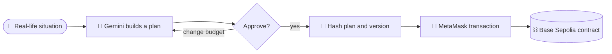
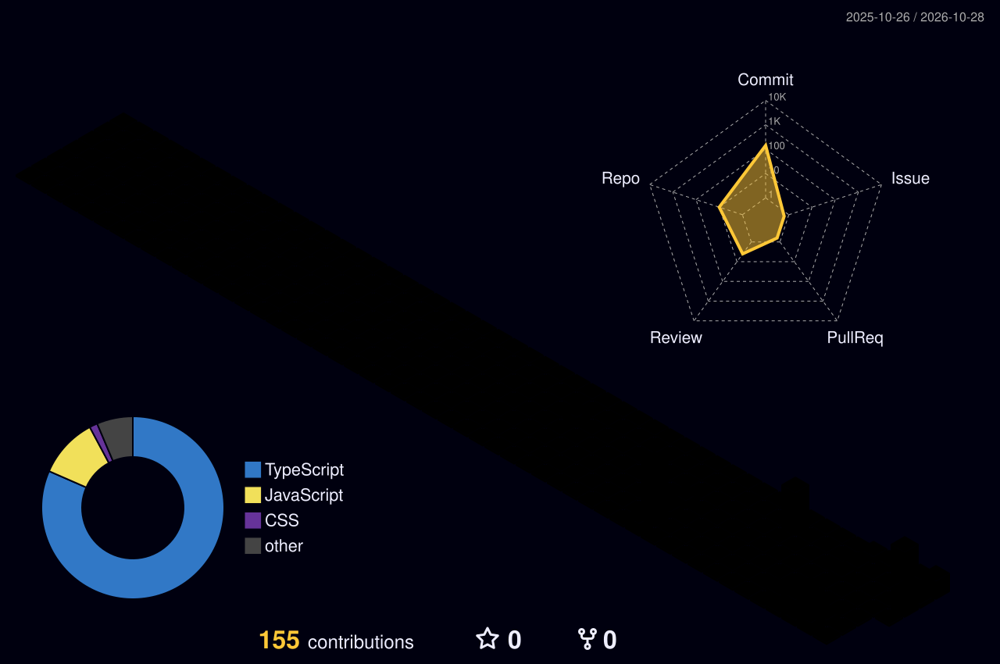

<!--
  SETUP: search & replace these three placeholders everywhere
    YOUR_USERNAME  -> your GitHub username
    REPO_NAME      -> the repo you want to pin as a card (optional)
  Also edit the name inside assets/banner.svg (search for "YOUR NAME", two places).
-->

 

 

<h2 align="center">About me</h2>

- 🛍️ Building **Intora**, an AI shopping agent that turns real-life situations into budget-friendly plans.
- ⛓️ Approved plans are hashed and recorded on-chain, so every version has a verifiable history.
- 🌱 Currently learning: `[edit me]`
- 💬 Ask me about: `[edit me]`
- ⚡ Fun fact: `[edit me]`

 

<h2 align="center">Featured project: Intora</h2>

Tell it your situation and budget. Gemini builds the shopping plan, you tweak it, and the approved version gets committed on-chain.

<a href="https://intora-wgyv.vercel.app/"><b>Open the live site</b></a>

<!-- Optional: pin your Intora repo as a card. Replace REPO_NAME, or delete this block. -->

 

<h2 align="center">Tech stack</h2>

<!-- Edit the icon list: https://github.com/tandpfun/skill-icons#icons-list -->

  

 

<h2 align="center">GitHub stats</h2>

 

 

<h2 align="center">My contributions in 3D</h2>

<!-- Generated by .github/workflows/profile-animations.yml (run it once from the Actions tab) -->

  

 

  

 

<h2 align="center">Let's connect</h2>

<!-- Replace the links, delete the ones you don't use -->

